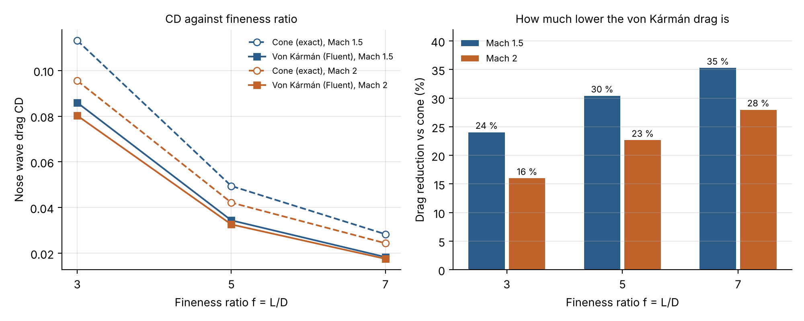
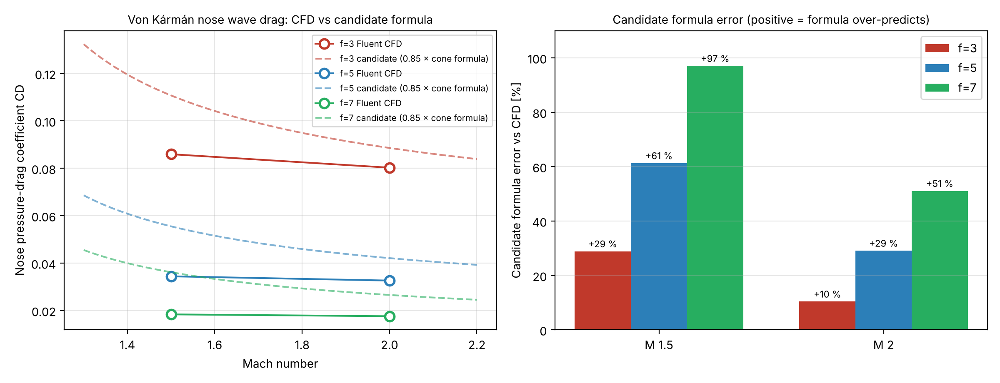

# YAADO #129 – Nose wave drag with CFD

Ansys Fluent 2026 R1 (Student) simulations of the supersonic **nose wave drag** of a **cone** and a **von Kármán (LD-Haack)** nose, for [YAADO issue #129](https://github.com/knnmelprop/YAADO/issues/129). The results feed the drag formulas in issue #75.

**Author:** Mohamad Bark · MELprop student club

## Results at a glance

**Cone:** 12 cases (f = 3, 5, 7 × Mach 1.5, 2, 3, 5). Every case is within **0.3 %** of the exact Taylor–Maccoll solution.

**Von Kármán:** 6 cases (f = 3, 5, 7 × Mach 1.5, 2). These are verified by:
- the shape matching the von Kármán formula to within 0.004 mm
- mesh independence: CD changes by 0.026 %
- an independent Cp integration that reproduces every Fluent CD to within 0.3 %

| f | Mach | CD cone (exact) | CD von Kármán (CFD) | VK below cone |
|:-:|:-:|:-:|:-:|:-:|
| 3 | 1.5 | 0.113151 | 0.085944 | 24.0 % |
| 3 | 2 | 0.095529 | 0.080258 | 16.0 % |
| 5 | 1.5 | 0.049448 | 0.034413 | 30.4 % |
| 5 | 2 | 0.042165 | 0.032612 | 22.7 % |
| 7 | 1.5 | 0.028344 | 0.018347 | 35.3 % |
| 7 | 2 | 0.024397 | 0.017574 | 28.0 % |

### The issue's candidate formulas

Both candidate formulas over-predict the drag in every case:
- **Cone:** +7.5 % to +50 % against the exact solution.
- **Von Kármán** (0.85 × cone formula): +10 % to +97 % against the CFD.

The real von Kármán / cone ratio is not a fixed 0.85. It runs from 0.65 to 0.84, getting smaller as f rises and as Mach drops. See [`von_karman/formula_check`](von_karman/formula_check).

## Method

- **Flow model:** 2D axisymmetric, inviscid (Euler), density-based solver with the Roe-FDS flux. Air is an ideal gas, and the operating pressure is 0.
- **Boundaries:**
  - pressure far-field: 101325 Pa, 288.15 K
  - pressure outlet: backflow total temperature 417.8 K (Mach 1.5), 518.7 K (Mach 2), 806.8 K (Mach 3), 1728.9 K (Mach 5)
- **Reference values:** computed from the far-field each time. Area = πR² = 0.007853982 m², length = 0.1 m.
- **CD:** the pressure drag on the nose surface only.
- **Mesh:** all-quad, 2 mm globally, with hard edge sizing along the nose and the axis: 0.25 mm for the cone, 0.2 mm for the von Kármán.
- **Solution:** first-order upwind, then second-order upwind until CD is constant.

## Repository layout

| Folder | Contents |
|---|---|
| [`reports/`](reports) | Full PDF reports for the cone and the von Kármán nose |
| [`cone/`](cone) | Cone results, mesh study, CSV data and all simulation pictures |
| [`von_karman/`](von_karman) | Von Kármán results, geometry files (nose point files for DesignModeler), shape check, pictures, candidate-formula check |
| [`github_comments/`](github_comments) | The result comments posted on issue #129 |
